&nbsp;&nbsp;&nbsp;&nbsp;&nbsp;&nbsp;

 
 
 
 
 

<picture><source media="(prefers-color-scheme: dark)" srcset="https://github-readme-stats.vercel.app/api?username=javimoralesg&show_icons=true&include_all_commits=true&hide_rank=true&hide_title=true&hide=issues%2Ccontribs&show=prs_merged&bg_color=172330&text_color=b5c0cd&icon_color=d6b27b&title_color=92b7e4&border_color=31404e&border_radius=8&line_height=32&card_width=420"></picture> <picture><source media="(prefers-color-scheme: dark)" srcset="https://streak-stats.demolab.com?user=javimoralesg&background=172330&border=31404e&stroke=31404e&ring=92b7e4&fire=d6b27b&currStreakNum=edf0ee&sideNums=92b7e4&currStreakLabel=92b7e4&sideLabels=b5c0cd&dates=a0adbc&border_radius=8&card_width=420&card_height=175"></picture>

<picture><source media="(prefers-color-scheme: dark)" srcset="https://raw.githubusercontent.com/javimoralesg/javimoralesg/output/github-snake-dark.svg"></picture>

